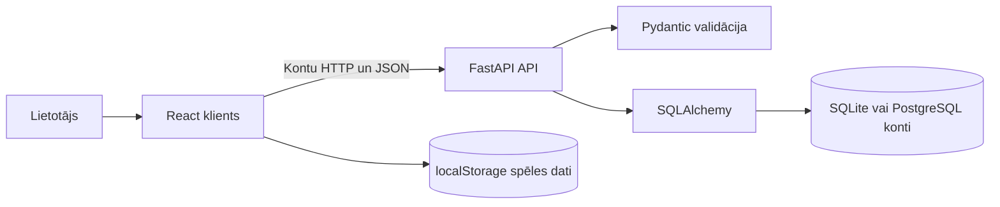
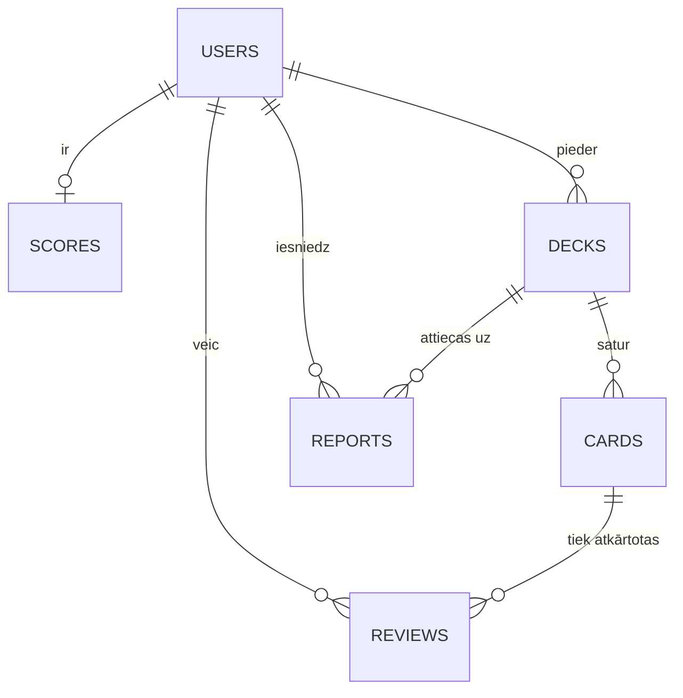

# 6 Sistēmas arhitektūra un dati

## 6.1 Datu plūsma

Pārlūks sūta reģistrācijas un pieslēgšanās pieprasījumus FastAPI serverim. Pydantic pārbauda ievadi, SQLAlchemy izpilda datubāzes darbības, bet pwdlib pārbauda paroles. Serveris izsniedz parakstītu JWT, kuru klients pievieno `/api/auth/me` pieprasījumam.

Diagrammā ir divas atsevišķas glabātuves. Lietotāju kopas un kartītes tiek sūtītas API, bet spēles progress un RP pagaidām paliek localStorage. Lokāli izmanto SQLite, bet Render demonstrācijā PostgreSQL 18. PostgreSQL kontu dati saglabājas atsevišķi no API īslaicīgās failu sistēmas.

## 6.2 Servera moduļi

| Fails | Atbildība |
|---|---|
| `config.py` | Vides mainīgie, JWT parametri un noklusējuma DB ceļš |
| `database.py` | Savienojumi, sesijas un SQLite ārējo atslēgu ieslēgšana |
| `models.py` | Astoņu tabulu SQLAlchemy modeļi |
| `schemas.py` | Pieprasījumu un atbilžu shēmas |
| `auth.py` | JWT izveide, pašreizējais lietotājs un administratora pārbaude |
| `routers.py` | Reģistrācija, pieslēgšanās un konta nolasīšana |
| `main.py` | FastAPI dzīves cikls, CORS un `/health` |

## 6.3 Tabulas un lauki

`PK` nozīmē primāro atslēgu, `FK` ārējo atslēgu. Pilns sākotnējās shēmas SQL ir `backend/schema.sql`. Tas ir struktūras apraksts; lietotne tabulas veido no modeļiem.

| Tabula | Lauki | Lietojums šajā versijā |
|---|---|---|
| `users` | `id` PK, `email` unikāls, `password_hash`, `display_name`, `role`, `created_at` | Kontu API lasa un raksta |
| `scores` | `user_id` PK un FK, `total_rp`, `week_rp`, `week_start`, `streak_days`, `last_study_date`, `league` | Konta izveidē pievieno sākuma rindu; spēle to neatjauno |
| `decks` | `id` PK, `owner_id` FK, `title`, `description`, `category`, `language`, `is_public`, `created_at` | Sagatavots turpmākai integrācijai |
| `cards` | `id` PK, `deck_id` FK, `front`, `back`, `created_at`, `updated_at` | Sagatavots turpmākai integrācijai |
| `reviews` | `id` PK, `user_id` FK, `card_id` FK, `reviewed_at`, `rating`, `next_review_at`, `interval`, `ease_factor` | Sagatavots turpmākai integrācijai |
| `categories` | `id` PK, `name` unikāls | Vēl nav API un nav sasaistes ar `decks.category` |
| `reports` | `id` PK, `deck_id` FK, `reporter_id` FK, `reason`, `status`, `created_at` | Sagatavots turpmākai moderācijai |

`password_hash` ir pieļauta NULL vērtība datu modelī, taču pašreizējā reģistrācija vienmēr saglabā jaucējvērtību. Konts bez jaucējvērtības ar paroli nepieslēdzas. `decks.category` pagaidām ir teksts, nevis ārējā atslēga uz `categories`.

## 6.4 Saites

Kategoriju tabula shēmā paliek neatkarīga. Kartīšu un kopu dzēšanas API vēl nav. Pirms tās ieviešanas jāsaskaņo saistīto atsauksmju un ziņojumu dzēšanas politika. SQLite ārējās atslēgas ieslēdz katrā savienojumā, lai nepieļautu atsauces uz neesošiem ierakstiem.

## 6.5 Transakcijas un laiks

Reģistrācijas transakcijā izveido `users` un `scores` rindas. E-pasta unikālais ierobežojums pasargā arī no vienlaicīgiem reģistrācijas pieprasījumiem. Ja e-pasts jau aizņemts, transakciju atceļ un atbild ar 409. Paroles jaucējvērtība nekad nav `UserResponse` atbildē.

Servera datumi tiek glabāti UTC. SQLite datuma laukiem nav laika joslas, tādēļ konta API atbildē UTC apzīmējumu pievieno serializēšanas laikā. Spēles dienas un nedēļas aprēķini joprojām izmanto klienta laiku; pirms kopīgas sacensību sistēmas tas jāpārvieto uz serveri.

## 6.6 Klienta kontu nošķiršana

Pirms profila ielādes API pārbauda marķieri. Pēc tam Zustand stāvokli atiestata bez iepriekš saglabāto datu pārrakstīšanas un ielādē attiecīgā konta atslēgu `rrv-account:<id>:<created_at>`. Datuma daļa ir URL kodēta. Reģistrācijas laiks atšķir arī kontus pēc DB atkārtotas izveides. Veco koplietoto atslēgu automātiski neimportē, jo tās īpašnieku nevar droši noteikt.

Klients saglabā agrāk izvēlēto vietējo vārdu un avatāru. Lomu pēc sesijas pārbaudes piešķir no servera atbildes. Tīkla vai servera kļūdas gadījumā marķieri saglabā un spēli neatver, kamēr sesija nav pārbaudīta. Citā cilnē veiktas konta izmaiņas izraisa pārlādi. Pēc JWT termiņa pārbaudi atkārto; serveris pats nosaka marķiera derīgumu.

Klienta kartītei ir `question`, `answer` un nepareizie varianti, bet servera modelim ir `front` un `back`. Pirms integrācijas vajag vienotu datu līgumu un migrāciju. Esošas tabulas vien nenozīmē, ka visi spēles dati jau glabājas datubāzē.

## 6.7 Kopu koplietošana

Jaunā `shared_decks` tabula glabā `id`, `owner_id`, `is_public`, `is_deleted`, `payload` un `revision`. `payload` ir validēts JSON ar klienta kopas metadatiem, kartītēm, nepareizajiem atbilžu variantiem un paskaidrojumiem. Papildinoša tabula izvēlēta, lai saglabātu esošās datubāzes shēmu un klienta identifikatorus. Iepriekšējās `decks` un `cards` tabulas paliek sagatavotas normalizēta modeļa turpmākai integrācijai.

API atgriež īpašnieka kopas un citu lietotāju publiskās kopas. Īpašnieku un autoru nosaka no autentificētā konta. Labošanai un dzēšanai vajag aktuālo `revision`; SQL atjauninājuma nosacījums neļauj vecai cilnei pārrakstīt jaunāku versiju. Dzēšana izņem saturu un saglabā ID marķieri, kas neļauj vecam pārlūkam atkārtoti importēt dzēsto kopu.

Pēc pieslēgšanās klients importē vēl neaugšupielādētas lokālās kopas un ielādē redzamo sarakstu. Ielādes kļūda nedzēš lokālos datus vai konta marķieri. Citi lietotāji neiegūst tiesības rediģēt publisku kopu.
